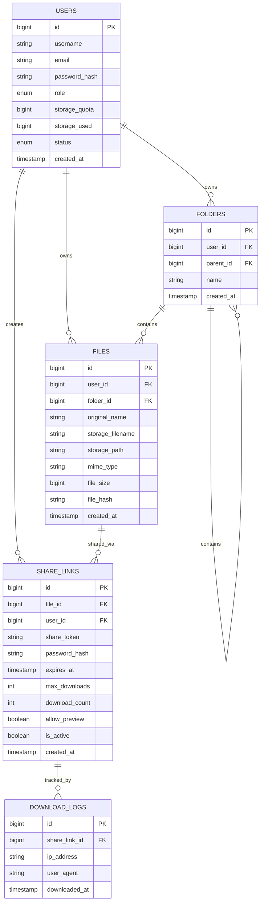

# Database Schema - File Sharing System (MariaDB / MySQL)

Database: `filesharing_db`  
Engine: `InnoDB`  
Charset: `utf8mb4`  
Collation: `utf8mb4_unicode_ci`

---

## 1. Diagram Relasi Entitas (ERD)



---

## 2. Definisi Tabel & High-Performance Indexing (DDL SQL)

```sql
-- 1. Tabel Users
CREATE TABLE `users` (
    `id` BIGINT UNSIGNED AUTO_INCREMENT PRIMARY KEY,
    `username` VARCHAR(50) NOT NULL UNIQUE,
    `email` VARCHAR(100) NOT NULL UNIQUE,
    `password_hash` VARCHAR(255) NOT NULL,
    `role` ENUM('admin', 'user') NOT NULL DEFAULT 'user',
    `storage_quota` BIGINT UNSIGNED NOT NULL DEFAULT 5368709120, -- Default: 5 GB dalam bytes
    `storage_used` BIGINT UNSIGNED NOT NULL DEFAULT 0,
    `status` ENUM('active', 'suspended') NOT NULL DEFAULT 'active',
    `created_at` TIMESTAMP DEFAULT CURRENT_TIMESTAMP,
    `updated_at` TIMESTAMP DEFAULT CURRENT_TIMESTAMP ON UPDATE CURRENT_TIMESTAMP,
    INDEX `idx_users_status_role` (`status`, `role`)
) ENGINE=InnoDB DEFAULT CHARSET=utf8mb4 COLLATE=utf8mb4_unicode_ci;

-- 2. Tabel Folders
CREATE TABLE `folders` (
    `id` BIGINT UNSIGNED AUTO_INCREMENT PRIMARY KEY,
    `user_id` BIGINT UNSIGNED NOT NULL,
    `parent_id` BIGINT UNSIGNED NULL DEFAULT NULL,
    `name` VARCHAR(255) NOT NULL,
    `created_at` TIMESTAMP DEFAULT CURRENT_TIMESTAMP,
    `updated_at` TIMESTAMP DEFAULT CURRENT_TIMESTAMP ON UPDATE CURRENT_TIMESTAMP,
    CONSTRAINT `fk_folders_user` FOREIGN KEY (`user_id`) REFERENCES `users` (`id`) ON DELETE CASCADE,
    CONSTRAINT `fk_folders_parent` FOREIGN KEY (`parent_id`) REFERENCES `folders` (`id`) ON DELETE CASCADE,
    INDEX `idx_user_parent` (`user_id`, `parent_id`),
    INDEX `idx_folders_user_name` (`user_id`, `name`)
) ENGINE=InnoDB DEFAULT CHARSET=utf8mb4 COLLATE=utf8mb4_unicode_ci;

-- 3. Tabel Files
CREATE TABLE `files` (
    `id` BIGINT UNSIGNED AUTO_INCREMENT PRIMARY KEY,
    `user_id` BIGINT UNSIGNED NOT NULL,
    `folder_id` BIGINT UNSIGNED NULL DEFAULT NULL,
    `original_name` VARCHAR(255) NOT NULL,
    `storage_filename` VARCHAR(100) NOT NULL, -- UUIDv4 / Random Hex
    `storage_path` VARCHAR(255) NOT NULL,     -- misal: uploads/2026/10/
    `mime_type` VARCHAR(100) NOT NULL,
    `file_size` BIGINT UNSIGNED NOT NULL,     -- Dalam bytes
    `file_hash` CHAR(64) NULL,                -- SHA-256 untuk deduplikasi / integrity check
    `created_at` TIMESTAMP DEFAULT CURRENT_TIMESTAMP,
    `updated_at` TIMESTAMP DEFAULT CURRENT_TIMESTAMP ON UPDATE CURRENT_TIMESTAMP,
    CONSTRAINT `fk_files_user` FOREIGN KEY (`user_id`) REFERENCES `users` (`id`) ON DELETE CASCADE,
    CONSTRAINT `fk_files_folder` FOREIGN KEY (`folder_id`) REFERENCES `folders` (`id`) ON DELETE SET NULL,
    INDEX `idx_files_user_folder` (`user_id`, `folder_id`),
    INDEX `idx_files_user_created` (`user_id`, `created_at`),
    INDEX `idx_files_user_name` (`user_id`, `original_name`),
    INDEX `idx_files_hash` (`file_hash`)
) ENGINE=InnoDB DEFAULT CHARSET=utf8mb4 COLLATE=utf8mb4_unicode_ci;

-- 4. Tabel Share Links
CREATE TABLE `share_links` (
    `id` BIGINT UNSIGNED AUTO_INCREMENT PRIMARY KEY,
    `file_id` BIGINT UNSIGNED NOT NULL,
    `user_id` BIGINT UNSIGNED NOT NULL,
    `share_token` VARCHAR(64) NOT NULL UNIQUE, -- Token URL unik
    `password_hash` VARCHAR(255) NULL DEFAULT NULL,
    `expires_at` DATETIME NULL DEFAULT NULL,
    `max_downloads` INT UNSIGNED NULL DEFAULT NULL,
    `download_count` INT UNSIGNED NOT NULL DEFAULT 0,
    `allow_preview` TINYINT(1) NOT NULL DEFAULT 1,
    `is_active` TINYINT(1) NOT NULL DEFAULT 1,
    `created_at` TIMESTAMP DEFAULT CURRENT_TIMESTAMP,
    `updated_at` TIMESTAMP DEFAULT CURRENT_TIMESTAMP ON UPDATE CURRENT_TIMESTAMP,
    CONSTRAINT `fk_shares_file` FOREIGN KEY (`file_id`) REFERENCES `files` (`id`) ON DELETE CASCADE,
    CONSTRAINT `fk_shares_user` FOREIGN KEY (`user_id`) REFERENCES `users` (`id`) ON DELETE CASCADE,
    INDEX `idx_token` (`share_token`),
    INDEX `idx_status_expiry` (`is_active`, `expires_at`),
    INDEX `idx_shares_file_active` (`file_id`, `is_active`),
    INDEX `idx_shares_user` (`user_id`)
) ENGINE=InnoDB DEFAULT CHARSET=utf8mb4 COLLATE=utf8mb4_unicode_ci;

-- 5. Tabel Download Logs (Audit)
CREATE TABLE `download_logs` (
    `id` BIGINT UNSIGNED AUTO_INCREMENT PRIMARY KEY,
    `share_link_id` BIGINT UNSIGNED NOT NULL,
    `ip_address` VARCHAR(45) NOT NULL,
    `user_agent` TEXT NULL,
    `downloaded_at` TIMESTAMP DEFAULT CURRENT_TIMESTAMP,
    CONSTRAINT `fk_logs_share` FOREIGN KEY (`share_link_id`) REFERENCES `share_links` (`id`) ON DELETE CASCADE,
    INDEX `idx_share_link` (`share_link_id`),
    INDEX `idx_logs_downloaded` (`downloaded_at`)
) ENGINE=InnoDB DEFAULT CHARSET=utf8mb4 COLLATE=utf8mb4_unicode_ci;
```
